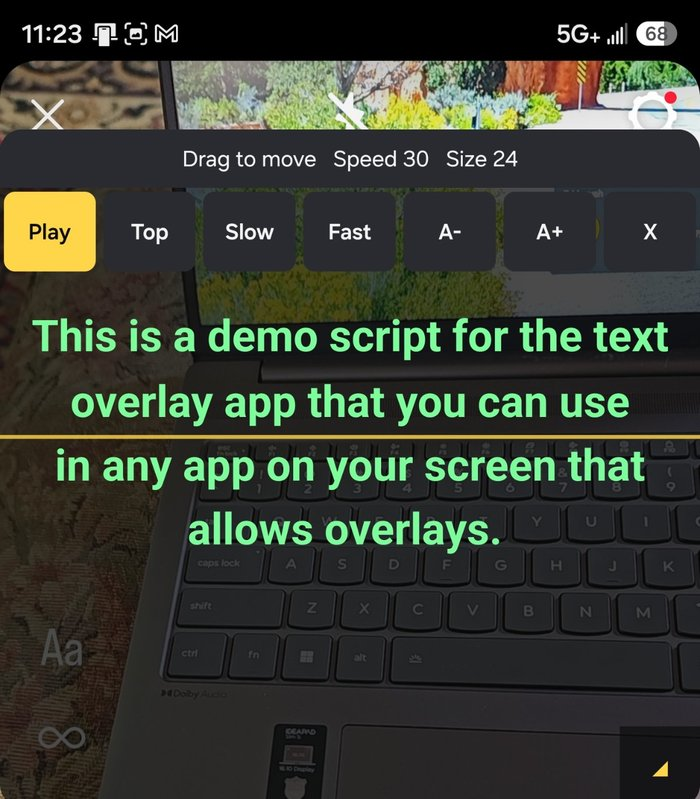

# Prompter

A floating teleprompter for Android. The script window sits on top of any app, including your camera app, so you can read while you record.

Native Kotlin. Android 8.0 (API 26) or later. Android only. No third-party runtime dependencies. No accounts, no network access, no tracking.

I built it for my own use and I use it on my phone.

## What it does

- Script editor with one saved script
- Floating window you drag by the top bar and resize from the bottom-right corner
- Controls on the window: Play, Top, Slow, Fast, A-, A+, Close
- Touch-scroll by hand at any time. Playback resumes from where you leave it.
- Settings for font, text color, text size, scroll speed, window opacity, countdown, and mirrored text
- Screen stays on while the window is showing

## Not included

Voice-paced scrolling, cloud sync, Bluetooth remote, recording, PDF or Word import, ads.

## Install

**Option A: build with GitHub Actions (no local setup)**

1. Fork or clone this repo.
2. Open the Actions tab and run "Build APK". It also runs on every push to `main`.
3. Download the `prompter-debug-apk` artifact, unzip it, and copy `app-debug.apk` to your phone.
4. Install it. Android will ask you to allow installs from your file manager or browser. That is expected for a debug build.

**Option B: Android Studio**

Open the folder, let Gradle sync, then run on a connected phone or build a debug APK.

## First run

1. Open Prompter, paste a script, adjust settings.
2. Tap Start overlay. The first time, Android opens "Display over other apps". Allow it for Prompter, press Back, and tap Start again.
3. The app moves to the background. Open your camera app. The script window floats over it.
4. Press Play on the window.

## Permissions

- **Display over other apps:** required. The floating window is the core function of the app.
- **Foreground service:** keeps the window alive while another app is in front.
- **Notifications:** shows the foreground service notification.

The app does not request internet access.

## Privacy

The app collects nothing. Your script and settings are stored on the device only.

## How it is built

- `OverlayService.kt` runs the floating window as a foreground service, drawn as an application overlay window
- `MainActivity.kt` is the script editor and settings screen
- `ScrollMath.kt` holds the scroll and window-clamp math, kept separate so it can be unit tested
- `Prefs.kt` stores settings and the script in app-private storage and clamps values on read, so bad data cannot crash the overlay
- `Brand.kt` and `res/values/colors.xml` hold the shared look for the settings screen and the overlay

CI runs the unit tests and builds a debug APK on every push to `main`.

## Tests

`./gradlew testDebugUnitTest` runs the scroll and window-clamp math tests. The service and activity are not covered by automated tests yet. I test those by hand on a device.

## License

MIT. See [LICENSE](LICENSE).
